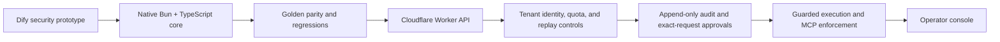
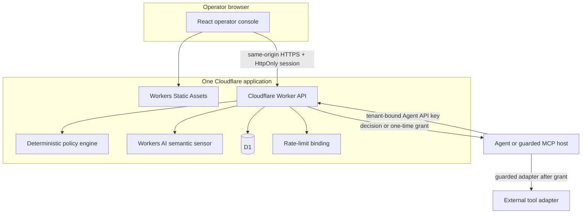
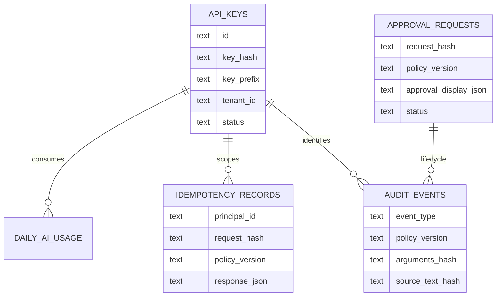

# Agent Action Gate architecture

Agent Action Gate is a runtime authorization boundary for proposed AI-agent
tool calls. The deterministic TypeScript policy engine is the authorization
authority. The semantic classifier contributes risk signals but cannot grant
access.

## Evolution



The exported Dify workflow remains the original behavioral reference. The
native implementation makes the trust boundaries explicit, adds regression
coverage for runtime coercion defects, and places persistence and operator
workflows around the policy core.

## Runtime topology



The SPA has no backend of its own. It calls the same-origin Worker and never
receives Cloudflare credentials. The operator key is submitted once to create
a short-lived signed cookie; it is not placed in browser storage or URLs.

## Authorization flow

```mermaid
sequenceDiagram
  participant A as Agent
  participant G as Gate
  participant P as Policy
  participant O as Human operator
  participant T as Guarded tool adapter

  A->>G: Proposed tool call
  G->>P: Normalized request + semantic signals
  P-->>G: ALLOW / DENY / REQUIRE_APPROVAL
  alt ALLOW
    G-->>A: Explicit ALLOW
    A->>T: Execute through guarded adapter
  else DENY
    G-->>A: DENY; no execution
  else REQUIRE_APPROVAL
    G-->>A: Pending approval ID
    O->>G: Review safe summary and approve/reject
    A->>G: Consume with exact original request
    G-->>A: One-time authorized=true or stable failure
    A->>T: Execute only after successful consume
  end
```

An approval decision is not an execution grant. The Agent must resubmit the
exact original request, and consumption must atomically transition the stored
approval once. The external adapter still needs its own idempotency key or
transactional outbox because a database grant cannot make an external side
effect exactly once across process and network failures.

## Identity and trust boundaries

- Agent API keys are tenant-bound. D1 stores their SHA-256 hashes and safe
  display prefixes, not raw credentials.
- `request_tenant` is compatibility input only. The authenticated principal is
  the tenant authority.
- Operator authority is separate from Agent authority. Agent credentials
  cannot approve, reject, query operator data, or manage keys.
- Browser operator sessions are short-lived, signed, `HttpOnly`, `Secure`, and
  `SameSite=Strict`. Same-origin validation protects cookie-authenticated
  state changes.
- Direct operator bearer authentication remains available for controlled CLI
  and smoke-test use.

## Policy versioning

The build exposes one immutable `POLICY_VERSION`. It is included in evaluation
and approval bindings and persisted with audit and approval records. This
prevents an idempotent response or approval created under one policy version
from silently becoming authority under another. A version change is an
explicit authorization-context change, not presentation metadata.

## Approval privacy and human context

The immutable request hash remains the approval and consumption authority.
`approval_display_json` is a separate, tool-specific, allowlisted projection
for human review:

- `email.send`: recipient, optional subject, and whether attachments are
  present; never the body or attachment contents.
- `refund.create`: minor-unit amount and optional currency/order identifier.
- Other tools: a generic summary with no arbitrary argument dump.

The display object is untrusted presentation data. Editing it cannot alter the
bound request, and authorization code never compares or executes from it. Raw
`source_text` is not stored.

## Persistence



Audit history is append-only. Approval identity fields, including policy
version and display projection, are immutable after insertion. Valid lifecycle
transitions append audit evidence in the same D1 statement.

## Operator surface

The console provides:

- an overview backed by bounded aggregate queries;
- a pending-approval inbox with confirmation before approval;
- a filtered audit timeline;
- one-time API-key issuance and revocation;
- a read-only rendering of the built-in policy; and
- integration guidance for HTTP, TypeScript, and MCP callers.

The UI maps stable policy codes to readable labels without removing the
machine code from API data. It renders server data as text and uses no
third-party analytics or trackers.
