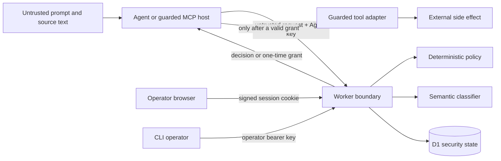

# Agent Action Gate threat model

## Scope

This model covers the Worker API, deterministic policy core, semantic risk
sensor, D1 security state, guarded execution boundary, MCP example, and the
same-origin operator console. It does not claim to secure an arbitrary tool
implementation after a valid grant has been handed to it.

## Assets

- Tenant data reachable through tools.
- Agent and operator credentials.
- Authorization decisions and one-time approval grants.
- Approval integrity and operator intent.
- Audit history.
- Per-principal AI quota and service availability.
- Policy code, version, and configuration.

## Trust boundaries

All request fields, classifier output, browser input, and MCP arguments are
untrusted. D1 is trusted only through checked schemas and repository methods;
database errors fail closed.

## Threat actors

- A malicious user who controls prompt or retrieved content.
- A compromised or buggy Agent process.
- A tenant attempting to cross into another tenant.
- A holder of a stolen Agent or operator credential.
- An attacker able to trigger retries, races, malformed requests, or quota
  exhaustion.
- A compromised upstream classifier returning malformed or adversarial data.

## Threats, mitigations, and residual risk

| Threat | Primary mitigations | Residual risk |
| --- | --- | --- |
| Indirect prompt injection | Semantic signals can force denial; deterministic rules remain the authority; strong signal codes are audited. | Classifiers can miss attacks. Safe tool design and least privilege remain necessary. |
| Tool misuse | Known-tool allowlist, per-tool deterministic policy, normalized arguments, guarded execution. | An allowed low-risk tool can still have implementation defects or excessive privileges. |
| Data exfiltration | Exfiltration signals deny; exports and secret reads are blocked; email sends require approval. | Novel channels or an overly capable downstream tool may evade the modeled policy. |
| Cross-tenant access | Tenant is derived from the authenticated principal; every known tool requires a matching target tenant; principal/tenant authority is immutable. | A tool backend must also enforce tenant scoping; the gate cannot repair a backend that ignores it. |
| Stolen Agent API key | Only hashes are stored; keys are tenant-bound, revocable, rate-limited, and quota-limited; Agent keys have no operator authority. | Until revoked, an attacker can act within the key's tenant and limits. Key rotation and external secret hygiene are operational duties. |
| Quota abuse | Burst rate limiting plus atomic per-principal daily D1 quota. | Distributed denial of service and Cloudflare-account limits are outside the application quota model. |
| Approval substitution | Approval hash binds principal, trusted tenant, normalized action, source digest, policy result, and policy version. Consumption recomputes the hash. | A human can still misunderstand a safe summary or intentionally approve a harmful action. |
| Replay | Idempotency records are principal-scoped and version-bound; approvals use an atomic one-time transition; stable conflicts fail closed. | An external tool call can be retried after the gate's successful grant unless the adapter also implements idempotency. |
| Operator credential compromise | Operator authority is separate; the browser uses a short-lived signed HttpOnly cookie; state changes validate Origin; no key is persisted in browser storage. | V0.1 has one shared operator identity, no individual accountability, MFA, device binding, or server-side session revocation list. Logout clears the browser cookie, but a separately captured pre-logout cookie remains valid until its eight-hour expiry; rotating the operator key invalidates all derived sessions. |
| Audit tampering | Append-only D1 triggers prevent update, delete, and replacement; decisions fail closed if required audit persistence fails. | A sufficiently privileged Cloudflare account administrator can replace infrastructure or export/delete the whole database. Off-account archival is not implemented. |
| Malformed model output | Runtime validation accepts only the narrow semantic schema, including normalized boolean boundary values; errors deny. | A schema-valid false negative is still possible. |
| Classifier outage | Exceptions, timeouts, malformed results, and quota-storage errors fail closed; pre-semantic deterministic denials do not call AI. | Availability decreases during an outage, including benign actions that need classification. |
| CSRF and browser secret leakage | SameSite=Strict cookie, Secure/HttpOnly flags, same-origin mutation checks, no secret-bearing URLs/storage, CSP and security headers. | A same-origin script compromise can act through the current session even though it cannot read the cookie. Preventing XSS remains critical. |
| Approval display injection | Tool-specific projection, bounded fields, rejection of control/Unicode-format characters, text rendering, no dangerous HTML. The projection is never authorization authority, and a missing/invalid email recipient is labeled explicitly. | Ordinary Unicode confusables and socially misleading but allowlisted subject/order text may still influence a reviewer. The UI labels the data as request-supplied. |
| TOCTOU and external exactly-once | Exact request is checked immediately before atomic consumption; only one consumption succeeds. | The gate cannot atomically combine D1 consumption with a third-party side effect. A crash after consumption but before/after the external call requires downstream idempotency or an outbox. |

## Policy-version transition risk

A deployed policy change intentionally changes the request and approval
binding. Old approvals fail consumption and old idempotency entries cannot
replay under the new version. Operators should deploy migrations before code,
verify the exposed version, and expect in-flight approvals to require a fresh
evaluation when versions are incompatible.

## V0.1 residual risks

- Operator authentication is shared-secret based and does not identify
  individual humans.
- There is no MFA, SSO, role hierarchy, or centrally revocable server-side
  browser-session table.
- Audit retention, export, monitoring, and off-account integrity anchoring are
  not implemented.
- A real tool adapter must add least-privilege credentials, input validation,
  and downstream idempotency.
- Semantic detection is probabilistic and should be treated as defense in
  depth, not proof that content is safe.
- Availability depends on Cloudflare Workers, D1, rate limiting, and Workers
  AI. Fail-closed behavior favors safety over availability.
